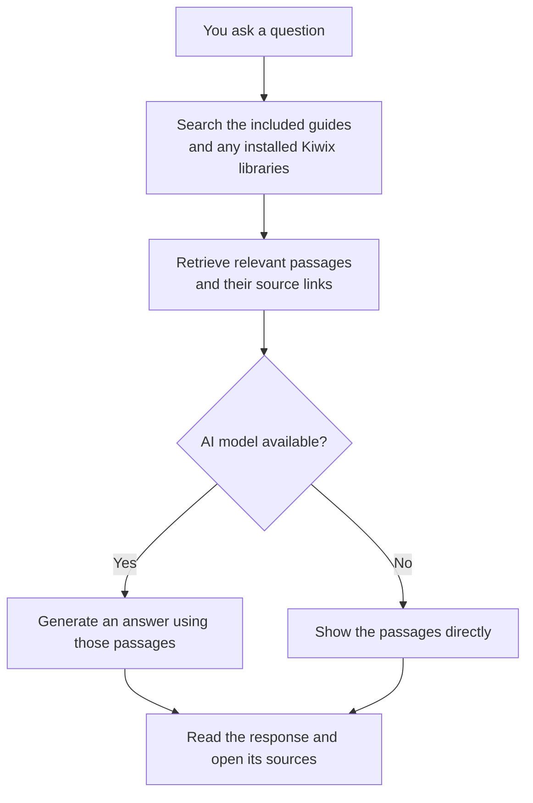

# Survival AI

**A survival assistant that works 100% without internet** — on Windows, Linux and macOS.

🇺🇸 English · [🇧🇷 Português](README.pt.md) · [🇪🇸 Español](README.es.md)

If the internet, power and services go down, this kit keeps working on a laptop or USB drive:

- 📚 **Practical guides with cited sources** (EN, PT, ES): water, fire, shelter, food, gardening and livestock, foraging/fishing/hunting, **first aid and medicine**, hygiene and homemade soap, **alcohol** (fermentation, distillation, antiseptic and fuel), solar power, radio and navigation, tools and knots, mental health and community, and checklists for 72 hours and **1 year**.
- 🤖 **Local AI** that answers any question in natural language, **citing its sources** — it runs on your own computer (llama.cpp or Ollama); nothing goes to the internet.
- 🌐 **Kiwix offline libraries**: medical Wikipedia, post-disaster manuals, *Where There Is No Doctor*, iFixit, Appropedia and more — the AI searches them too.
- 📱 **Web interface** in your browser, shareable over the local network (other phones connect via Wi-Fi, even with no internet).
- 🔍 **No-AI mode**: even without a model, guide search works on any PC with Python.

> ⚠️ **Disclaimer:** educational content. It does not replace doctors, firefighters or emergency services. Health guidance follows public guidelines (WHO, Red Cross/IFRC, AHA, CDC, Hesperian…) cited in each section.

---

## How it works

The kit combines **documents to read**, **software to search them**, and an optional **AI model to write answers**. You download the extra parts while you have internet, then use the saved copies offline. The included survival guides work without downloading a model or extra libraries.

See the [Glossary](#glossary) for explanations of the component names and file formats.



- **Works offline after setup:** guides, downloaded libraries, and the optional AI model stay on your computer.
- **The AI is optional:** it turns retrieved material into a conversational answer. Guide search works without it.
- **Sources remain visible:** readers can check the original material. If nothing relevant is found, the app says so.

| Part | What it is | Where |
|---|---|---|
| `survival.py` + `app/` | Application and search logic (Python standard library only, no `pip install`) | repository |
| `knowledge/pt|en|es/` | Survival guides in Markdown | repository |
| `knowledge/extra/` | **Your** `.md`/`.txt` documents (searched and cited by the AI) | repository |
| `runtime/llama.cpp/` | Engine that runs the AI model | downloaded by the preparer |
| `models/*.gguf` | Language model (1–5 GB) | downloaded by the preparer |
| `runtime/kiwix-tools/` + `zim/*.zim` | Kiwix server and libraries | downloaded by the preparer |
| `runtime/python/` | Portable Python (for PCs without Python) | downloaded by the preparer |

Keep downloaded models, libraries and runtimes out of git: the repository stays small and everyone builds their own kit with the preparer.

---

## Quick start

### 1. Get the repository

```bash
git clone https://github.com/skanga/Survival-AI.git
cd Survival-AI
```

### 2. Prepare the kit (online, once)

| System | How to run |
|---|---|
| **Windows** | double-click `prepare-kit.bat` |
| **macOS** | double-click `prepare-kit.command` (first time: right-click › Open) |
| **Linux** | `./prepare-kit.sh` |

Each preparation run checks for the newest available llama.cpp build for the selected platforms, upgrades older installations, and skips re-downloading the current build. Normal offline startup never checks for updates.

Preparation verifies model checksums and Kiwix metalink sizes/checksums. A failed ZIM update keeps the previous library, and interrupted downloads remain available for retry. Invalid selections and failed preparation return a nonzero exit code; `runtime/kit-info.json` records the result of each requested component.

The active Kiwix profiles contain 15 catalog entries. WikEM and wikiHow are absent from the current official catalog (checked November 12, 2026), but older copies are available as [optional archived libraries](#optional-archived-libraries). Archives are excluded from every profile, including `full`. Profile sizes below exclude the model and runtimes and change with upstream releases.

The preparer asks for:

1. **AI model:** `light` (light, 1 GB, 4 GB RAM), `standard` (default, 2 GB, 8 GB RAM — recommended), `strong` (strong, 4.7 GB, 16 GB RAM).
2. **Kiwix libraries:** `minimal` (~3 GiB), `recommended` (~8 GiB) or `full` (~77 GiB, Wikipedia without images).
3. **Optional archived libraries:** older WikEM/wikiHow snapshots; **None** is the default. Each option shows its date and size.
4. **Systems:** this computer only, or **Windows + Linux + macOS** (universal USB kit).
5. **Portable Python:** so the kit opens on computers without Python.

Non-interactive:

```bash
python survival.py prepare --model standard --zims recommended --os all --python
```

### 3. Use it (offline)

| System | How to open |
|---|---|
| **Windows** | `start.bat` (or double-click it) |
| **macOS** | `start.command` |
| **Linux** | `./start.sh` |

Your browser opens <http://127.0.0.1:8090>. Switch language anytime with the PT/EN/ES buttons. English is the default. Select Portuguese or Spanish with `--lang pt` or `--lang es`, or use the language buttons.

### 4. Carry it on a USB drive

Copy **the whole folder** to a USB drive or external disk formatted as **exFAT** (works on all three systems and supports files over 4 GB).

---

## Optional archived libraries

These are **historical snapshots**, separate from the current catalog downloads. They are never selected by `--yes` or any `--zims` profile. Setup, the saved kit manifest, and the assistant's source citations identify archived libraries and their dates. If a library has no date in its name or publication metadata, citations say that its snapshot date is unknown.

| Selection ID | Library | Archived edition | Download size | Hosted by |
|---|---|---|---|---|
| `wikem` | WikEM, English | **June 2020** | 60 MiB | [Internet Archive](https://archive.org/details/wikem_en_all_maxi_2020-06.zim) |
| `wikihow-en` | wikiHow, English | **March 2023** | 47.7 GiB | [Kiwix archive](https://archive.download.kiwix.org/zim/wikihow/) |
| `wikihow-es` | wikiHow, Spanish | **September 2024** | 25.3 GiB | [Kiwix archive](https://archive.download.kiwix.org/zim/wikihow/) |
| `wikihow-pt` | wikiHow, Portuguese | **October 2024** | 10.4 GiB | [Kiwix archive](https://archive.download.kiwix.org/zim/wikihow/) |

**WikEM is an old medical reference for clinicians, not current clinical guidance.** All four collections may contain outdated instructions. The dates describe the saved editions, not when you download them. Selecting them again keeps those fixed editions; it does not refresh their content.

To add only the archived WikEM copy to an existing kit:

```bash
python survival.py prepare --model none --zims none --archives wikem --os this --yes
```

Use `--archives wikem,wikihow-en` for selected archives, or `--archives all` for all four (about **83.5 GiB**). Omit `--archives`, or use `--archives none`, to skip them. Skipping an archive does not remove a previously downloaded copy; move its `.zim` file out of `zim/` if you no longer want it searched. Extra archived editions do not replace other installed editions.

Archive downloads resume after interruptions. Before a file becomes available to Kiwix, the preparer checks its exact size, ZIM header and embedded MD5 checksum. These checks detect corruption; the embedded checksum does not authenticate the publisher. No published SHA-256 was found for these archived copies. Checking a large file can take several minutes. The direct URLs, byte counts, dates and source pages are recorded in [config/zims.json](config/zims.json).

## Other ways to use it

```bash
python survival.py chat                   # terminal chat
python survival.py ask "how do I make oral rehydration solution?"
python survival.py search burn
python survival.py status
python survival.py start --host 0.0.0.0             # share on the local network
python survival.py prepare --search survival        # find more Kiwix libraries
```

**Ollama:** if you use [Ollama](https://ollama.com), run `ollama pull qwen2.5:3b` — it is detected automatically. Any local OpenAI-compatible server (LM Studio, llamafile, KoboldCpp, Jan) also works: set `llm_url`.

**Kiwix Desktop:** [Kiwix Desktop](https://kiwix.org) can open the `.zim` files in `zim/`. To let the AI use its *Local Kiwix Server*, set `{ "kiwix_url": "http://127.0.0.1:<port>" }` in `config/settings.local.json`. The Windows Kiwix Desktop package (~150 MB) exceeds GitHub's 100 MB per-file limit — publish it as a **Release asset** instead of committing it.

## Add your own knowledge

Drop `.md` or `.txt` files in `knowledge/extra/` (family recipes, local maps, contacts, equipment manuals). They are indexed and cited by the AI.

To translate or expand the bundled guides, edit `knowledge/<language>/` and keep the same filenames across all three languages.

## Configuration

`config/settings.json` contains the defaults. Put overrides in `config/settings.local.json` to keep machine-specific choices separate from the shared settings. Keep that local file out of version control.

| Key | Default | Purpose |
|---|---|---|
| `language` | `en` | Default language (`en`, `pt`, `es`) |
| `web_port` | `8090` | Web interface port |
| `llm_backend` | `auto` | `auto`, `openai` (llama.cpp etc.), `ollama` or `none` |
| `model_file` | unset | Select a `.gguf` filename when several are installed |
| `llm_context` | `8192` | Model context size |
| `llm_threads` | `0` | CPU threads (0 = automatic) |
| `kiwix_url` | `http://127.0.0.1:8092` | Kiwix server address |
| `search_results` | `5` | Guide passages sent to the AI |

Ollama must have the exact configured model tag installed. An untagged name resolves to `:latest`; an absent model falls back to guide search.

For example, to select a different Ollama model:

```json
{ "ollama_model": "llama3.2:3b" }
```

The server limits request bodies to 64 KiB, accepts one answer stream at a time, and returns HTTP 503 while another answer is running. Share only with trusted devices: LAN clients can read all indexed documents, including `knowledge/extra/`.

With `--host 0.0.0.0`, devices connected to the same router can open the address printed in the terminal, such as `http://192.168.0.10:8090`, even without internet.

If Python is missing, install Python 3.8+ from <https://www.python.org/downloads/>. On Windows, select **Add python.exe to PATH**. The preparer can then include portable Python in the kit.

## English entry points

The launchers are now `start.bat`, `start.sh` and `start.command`; setup uses `prepare-kit.bat`, `prepare-kit.sh` and `prepare-kit.command`. The Python entry point is `survival.py`. Update existing shortcuts or scripts to these names.

Model IDs are `light`, `standard`, `strong` and `llama3b`. Library profiles are `minimal`, `recommended` and `full`. Use `none` to skip a model or library download. Existing downloaded model and ZIM filenames stay unchanged.

## Requirements

- **Minimum (search only):** any PC with Python 3.8+.
- **With AI:** 4 GB RAM (light model), 8 GB recommended; x86-64 CPU with AVX2 or Apple Silicon/ARM64. No GPU needed.
- **Disk:** 3 GB (minimal kit) to 100+ GB (full kit).

## Retrieval behavior

Search answers preserve complete guide sections. A section or Kiwix article that cannot fit the context budget is linked for reading in full instead of displaying a cut-off procedure. Search previews remain short; open the source for the complete instructions.

## Tests

```bash
python -B -m unittest discover -s tests
node --check web/app.js
```

GitHub Actions runs the Python tests on Windows, Linux and macOS with Python 3.11 and 3.14. The tests use temporary artifacts and mock services; they do not download full models or ZIM libraries.

## Licenses

Code: [MIT](LICENSE). Guides in `knowledge/`: [CC BY-SA 4.0](LICENSE-CONTENT.md). Models, Kiwix, llama.cpp and ZIM files downloaded by the preparer have their own licenses. The default model (Qwen2.5 3B) uses the *Qwen Research License*; for commercial use choose `light` or `strong` (Apache 2.0).

## Contributing

Corrections with sources, new guides and translations are welcome. Keep a `> Source:` line in each English section containing technical or health guidance, and use the equivalent source label in translated guides.

## Attribution

This fork is based on [IA da Sobrevivência](https://github.com/sdalberto/ia-da-sobrevivencia) by Silviano Dalberto Pessi (Ideias Livres Desenvolvimentos) and contributors. This version makes English the default and translates entry points, help, documentation and developer comments. Original license and copyright notices are retained.

## Glossary

| Name | In plain English |
|---|---|
| **[Kiwix](https://get.kiwix.org/en/)** | Free software for reading saved copies of websites without internet. This kit uses its small local server, `kiwix-serve`, so your browser and the assistant can open and search those copies. |
| **ZIM file (`.zim`)** | A compressed package of pages and their images, often an entire website or book collection. Put these files in `zim/`. They hold the reference material; the separate AI model writes answers from retrieved passages. |
| **Library / snapshot** | A collection saved at a particular time. A date such as `2024-09` means the September 2024 edition. Its pages do not update while you are offline. |
| **[WikEM](https://wikem.org/wiki/About_WikEM)** | An emergency medicine reference aimed at medical practitioners. The optional copy offered here is from **June 2020** and may contain outdated medical guidance. |
| **Medical Wikipedia / WikiMed** | Wikipedia articles about medicine and health, collected for offline reading. This is a separate collection from WikEM. The English collection is included in the smallest download profile. |
| **wikiHow** | Illustrated guides to everyday tasks, repairs and other practical activities. The optional archived editions here are from 2023 or 2024. |
| **iFixit, Appropedia, Energypedia** | Reference websites covering device repairs, practical sustainable technology, and energy respectively. Their offline copies are in the `recommended` profile. |
| **AI model / language model** | A large file of learned patterns that lets the computer generate text. It can make mistakes; the source links let you check its answers. You can use guide search without it. |
| **llama.cpp / Ollama** | Programs that run an AI model on your computer. The preparer installs llama.cpp; Ollama is an optional alternative if you already use it. |
| **GGUF (`.gguf`)** | The file format used for the models downloaded by this kit. Model files go in `models/`; library files go in `zim/`. |
| **Python / portable Python** | Python runs the Survival AI application. A portable copy travels inside the kit so another computer can run it without a separate installation. |
| **Preparer / profile** | The preparer is the setup tool launched by `prepare-kit`. A profile is a named bundle of libraries: `minimal`, `recommended` or `full`. |
| **GiB / MiB** | Units of file size: 1 GiB = 1,024 MiB, about 1.07 GB. Download sizes in this README are approximate; leave extra room for the model, software and future updates. |
