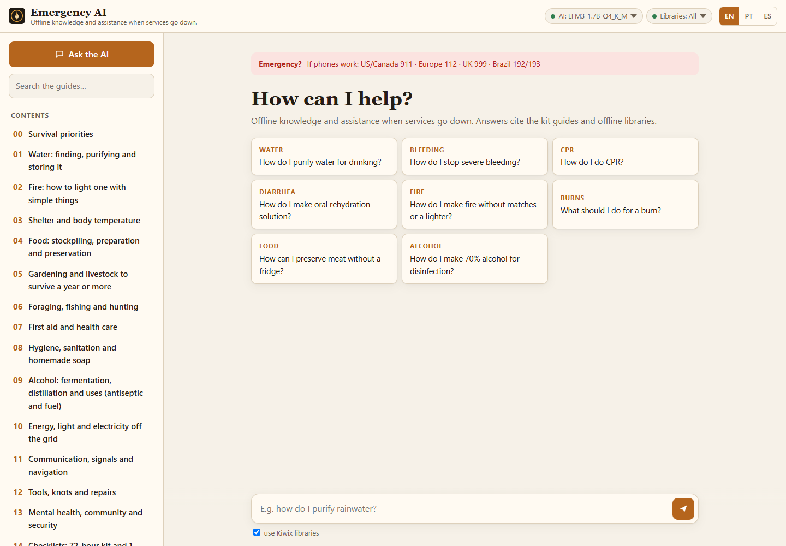

  

<h1 align="center">Emergency-AI</h1>

<strong>Conocimientos prácticos para emergencias, disponibles sin internet.</strong> Lee guías, busca en bibliotecas de referencia y haz preguntas sobre emergencias a una IA cuando no haya internet.

  <a href="#instalación"><strong>Instalar</strong></a> ·
  <a href="docs/getting-started.md">Primeros pasos</a> ·
  <a href="docs/using-emergency-ai.md">Guía de uso</a> ·
  <a href="docs/troubleshooting.md">Ayuda</a>

Windows · macOS · Linux <a href="README.md">English</a> · <a href="README.pt.md">Português</a> · Español

Descarga y configura Emergency-AI mientras tengas internet; después podrás usar las guías, las bibliotecas y el modelo de IA descargados sin conexión. La aplicación se abre en el navegador y funciona en tu computadora. Sigue necesitando energía; por ejemplo, una laptop con la batería cargada.

**Mira Emergency-AI en acción**

https://github.com/user-attachments/assets/653a4d45-961d-4599-a794-f7ebf48aed10

## Qué puedes hacer

| Función | Qué puedes hacer |
|---|---|
| **Guías incluidas** | Lee y busca información práctica sobre agua, alimentos, refugio, primeros auxilios, reparaciones, energía y otros temas, en inglés, portugués o español. |
| **Modelo de IA opcional** | Haz preguntas en lenguaje cotidiano. El modelo local utiliza fragmentos recuperados para redactar respuestas; los enlaces a las fuentes permiten comprobar el material. |
| **Bibliotecas adicionales** | Descarga colecciones de referencia, como Wikipedia de medicina, guías de reparación y manuales post-desastre, para usarlas sin conexión. |
| **Acceso desde el teléfono** | Usa el navegador de un teléfono conectado a la misma red local mientras la aplicación funciona en tu computadora. |
| **Tus documentos** | Añade documentos de texto al kit e inclúyelos en las búsquedas. |

**Puedes empezar sin IA.** Las guías incluidas están listas para leer y consultar sin descargar un modelo ni bibliotecas adicionales.

## Antes de empezar

- **Computadora:** Windows 10/11, macOS o Linux en un sistema x86-64 o ARM64 compatible. Consulta los [detalles de compatibilidad](docs/technical-reference.md#terminal-installation-and-platform-support).
- **Internet:** necesario para la instalación y las descargas opcionales. Prepara el kit antes de una interrupción del servicio.
- **Memoria:** se recomiendan 8 GB de RAM del sistema para el modelo ligero de IA. No se necesita una tarjeta gráfica dedicada. La búsqueda en las guías no requiere el modelo de IA.
- **Almacenamiento:** las bibliotecas adicionales empiezan en unos 3 GiB; el modelo ligero añade unos 1,1 GB. Reserva espacio adicional para el software, la extracción y las actualizaciones. Consulta las [opciones de descarga](docs/downloads.md). Usa `prepare --zims full --zim-languages es` para descargar solo bibliotecas en español; añade `--include-english-references` para incluir referencias en inglés. Se conservan los archivos existentes.

El instalador incluye Python, el software que ejecuta la aplicación. No necesitas instalar Python ni Git por separado.

### Espacio en disco aproximado

Estas son capacidades de almacenamiento sugeridas, no tamaños de instalación garantizados:

| Capacidad | Uso sugerido |
|---|---|
| **16 GB** | Bibliotecas `minimal` y el modelo ligero LFM3, para una plataforma sin paquetes CUDA opcionales. |
| **32 GB** | Bibliotecas `recommended` y el modelo equilibrado, para una plataforma. |
| **64 GB** | Bibliotecas `recommended` y el modelo equilibrado, con los componentes de ejecución para todas las plataformas compatibles y soporte opcional para GPU. |
| **256 GB o más** | Bibliotecas `full`, archivos históricos opcionales de wikiHow/WikEM, modelos adicionales y componentes de ejecución para varias plataformas. Comprueba el espacio disponible antes de descargarlo todo. |

Las **sugerencias de 16–64 GB excluyen Wikipedia completa y los archivos históricos opcionales**. Los requisitos reales varían según las descargas; reserva espacio para la extracción y las actualizaciones.

- Los modelos y los archivos de conocimiento se comparten entre plataformas, no se duplican para cada sistema operativo. Los componentes de ejecución específicos de cada plataforma ocupan espacio adicional.
- CUDA se refiere a los paquetes de ejecución CUDA del proyecto, no al kit completo de desarrollo ni a los instaladores de controladores de NVIDIA. La computadora donde se ejecuta el kit sigue necesitando controladores compatibles.
- Usa **exFAT en lugar de FAT32** para el almacenamiento entre plataformas: algunos archivos superan el límite de 4 GB por archivo de FAT32.
- El mayor modelo incluido actualmente en el catálogo, **Qwen3.8 27B**, recomienda **32 GB de RAM del sistema**. La capacidad del disco por sí sola no garantiza que funcione bien.
- Para cargar los modelos más rápido, usa una unidad USB 3 rápida o un SSD externo. Una mayor capacidad no implica un almacenamiento más rápido.

## Instalación

Crea una carpeta nueva y vacía donde quieras guardar Emergency-AI. Guarda en ella el instalador correspondiente a tu computadora. En GitHub, haz clic derecho en el enlace de descarga y elige **Guardar enlace como**.

| Computadora | Descarga | Ejecutar el instalador |
|---|---|---|
| **Windows** | [install.bat](https://raw.githubusercontent.com/skanga/Emergency-AI/main/install.bat) | Haz doble clic en `install.bat`. |
| **macOS** | [install.sh](https://raw.githubusercontent.com/skanga/Emergency-AI/main/install.sh) | Abre Terminal en esa carpeta y ejecuta `sh install.sh`. |
| **Linux** | [install.sh](https://raw.githubusercontent.com/skanga/Emergency-AI/main/install.sh) | Abre una terminal en esa carpeta y ejecuta `sh install.sh`. |

¿Necesitas ayuda para abrir una terminal o elegir las descargas? Sigue la guía de [primeros pasos](docs/getting-started.md). Los usuarios con experiencia pueden usar los [comandos de instalación en la terminal](docs/technical-reference.md#terminal-installation-and-platform-support).

**Instalación en Windows paso a paso (2:19)**: descarga el instalador, elige el modelo ligero y las bibliotecas mínimas, y después busca en una guía y haz una pregunta. Se han recortado las esperas largas de las descargas.

https://github.com/user-attachments/assets/3c3d246f-f09e-45c0-a4ba-8772f8008c8d

Cuando el instalador pregunte por la configuración inicial, elige **Y** para añadir la IA y las bibliotecas ahora. Para empezar con una instalación pequeña, elige **Recommended choices**, el modelo ligero **LFM3 1.7B**, las bibliotecas **minimal** y **this computer**. Selecciona estas opciones explícitamente; pulsar Enter en cada pregunta no selecciona necesariamente las bibliotecas mínimas.

Para empezar solo con las guías incluidas, omite la configuración inicial y abre la aplicación. En el menú del primer uso, elige **Use guides now and remember this choice**. Puedes añadir las descargas más adelante.

Las descargas pueden tardar mucho. Mantén abierta la ventana del instalador hasta que termine. Si falla una descarga, consulta las [instrucciones de recuperación](docs/troubleshooting.md#installation-or-downloads-stopped).

## Abre la aplicación y pruébala

Después de instalar, abre el lanzador de la carpeta Emergency-AI. Usa el mismo lanzador las próximas veces; no necesitas volver a instalar.

| Computadora | Abrir la aplicación |
|---|---|
| **Windows** | Haz doble clic en `run.bat`. |
| **macOS** | Haz doble clic en `run.command`. En el primer uso, haz clic derecho y elige **Abrir** si es necesario. |
| **Linux** | Abre una terminal en la carpeta y ejecuta `./run.sh`. |

El navegador debería abrirse en <http://127.0.0.1:8090>. Mantén abierta la ventana de terminal de la aplicación mientras la uses.

1. Abre una guía desde la barra lateral o busca un tema como **agua**.
2. Prueba a hacer una pregunta con **Ask the AI**. Si no hay un modelo, la aplicación muestra fragmentos de las fuentes.
3. Abre un enlace a una fuente debajo de la respuesta para leer el material original.

Antes de depender del kit sin conexión, [pruébalo sin internet](docs/getting-started.md#check-that-it-works-offline). Para detener la aplicación, vuelve a su ventana de terminal y pulsa **Ctrl+C**.

## Guías y ayuda

Estas guías se incluyen en la carpeta del proyecto para que puedas conservarlas con el kit. Los videos anteriores están alojados en internet.

| Quieres… | Consulta |
|---|---|
| Instalar por primera vez y elegir las opciones de configuración | [Primeros pasos](docs/getting-started.md) |
| Usar las guías, las preguntas, los idiomas y los enlaces a las fuentes | [Uso de Emergency-AI](docs/using-emergency-ai.md) |
| Conectar un teléfono | [Uso desde el teléfono](docs/using-emergency-ai.md#use-it-on-your-phone) |
| Elegir modelos o descargar más bibliotecas | [Descargas y modelos](docs/downloads.md) |
| Añadir documentos o trasladar el kit a otra computadora | [Guía de uso](docs/using-emergency-ai.md#add-your-own-documents) |
| Solucionar una descarga fallida o una aplicación que no se abre | [Solución de problemas](docs/troubleshooting.md) |
| Configurar motores, usar comandos de terminal o ejecutar pruebas | [Referencia técnica](docs/technical-reference.md) |

## Limitaciones

Emergency-AI es material educativo, no un sustituto de los servicios de emergencia ni de la atención médica profesional. Las respuestas de la IA pueden ser incorrectas, y una cita no demuestra que la fuente respalde la respuesta. Las guías incluidas tienen [problemas de contenido conocidos pendientes de revisión](TODO.md). Las bibliotecas descargadas son copias de un momento determinado y pueden contener información desactualizada.

El acceso desde la red local está activado de forma predeterminada. Los dispositivos conectados también pueden leer los documentos personales indexados. Consulta los [controles de acceso y uso compartido](docs/using-emergency-ai.md#use-it-on-your-phone).

## Contribuciones y licencias

Las correcciones con fuentes, las guías nuevas y las traducciones son bienvenidas. Mantén una línea `> Source:` en las secciones en inglés que contengan orientación técnica o de salud, y usa la etiqueta equivalente en las traducciones. Mantén los mismos nombres de archivo para las guías en todos los idiomas. Consulta las [comprobaciones para desarrolladores](docs/technical-reference.md#tests).

Código: [MIT](LICENSE). Guías incluidas: [CC BY-SA 4.0](LICENSE-CONTENT.md). El software, las bibliotecas y los modelos descargados tienen sus propias licencias; consulta las [opciones de modelos](docs/downloads.md#model-choices).

Basado en [IA da Sobrevivência](https://github.com/sdalberto/ia-da-sobrevivencia), de Silviano Dalberto Pessi (Ideias Livres Desenvolvimentos) y sus colaboradores. Se conservan los avisos originales de licencia y derechos de autor. Los códigos QR sin conexión que se muestran en la terminal utilizan el [codificador QR](app/vendor/README.md) de Project Nayuki, con licencia MIT.
