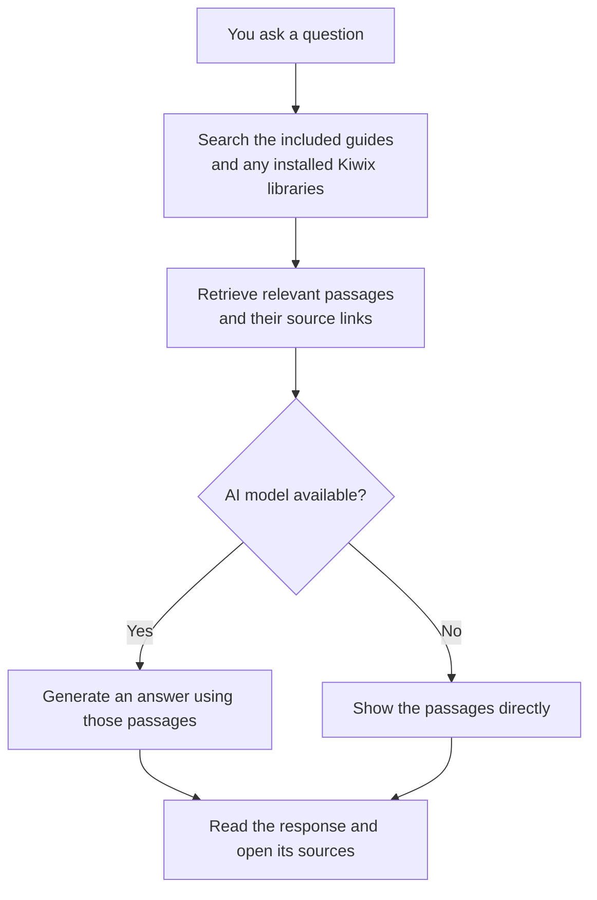

# Emergency AI

**Offline knowledge and assistance when services go down.**

For Windows, Linux and macOS.

🇺🇸 English · [🇧🇷 Português](README.pt.md) · [🇪🇸 Español](README.es.md)

Prepare the kit while you have internet, then use it when connectivity or services are unavailable. It runs on a powered computer, including a battery-powered laptop during an outage; a USB drive can store the kit for use on another computer:

- 📚 **Practical guides with cited sources** (EN, PT, ES): water, fire, shelter, food, gardening and livestock, foraging/fishing/hunting, **first aid and medicine**, hygiene and homemade soap, **alcohol** (fermentation, distillation, antiseptic and fuel), solar power, radio and navigation, tools and knots, mental health and community, and checklists for 72 hours and **1 year**.
- 🤖 **Local AI** that answers any question in natural language, **citing its sources** — it runs on your own computer (llama.cpp or Ollama); nothing goes to the internet.
- 🌐 **Kiwix offline libraries**: medical Wikipedia, post-disaster manuals, *Where There Is No Doctor*, iFixit, Appropedia and more — the AI searches them too.
- 📱 **Web interface** in your browser, shareable over the local network (other phones connect via Wi-Fi, even with no internet).
- 🔍 **No-AI mode**: even without a model, guide search works on any PC with Python.

> ⚠️ **Disclaimer:** educational content. It does not replace doctors, firefighters or emergency services. Health guidance follows public guidelines (WHO, Red Cross/IFRC, AHA, CDC, Hesperian…) cited in each section.

---

## Quick start

### 1. Download the kit (no Git or Python required)

Open a terminal in the folder where you want to keep the kit. The installer creates a new `Emergency-AI` subfolder, downloads the application and launchers, and adds a checksum-verified portable Python for this computer. It needs internet and no administrator rights.

**Windows (PowerShell):**

```powershell
curl.exe -fL https://raw.githubusercontent.com/skanga/Emergency-AI/main/install.bat -o install.bat
if ($LASTEXITCODE -eq 0) { .\install.bat }
```

**Linux / macOS:**

```sh
curl -fL https://raw.githubusercontent.com/skanga/Emergency-AI/main/install.sh -o install.sh && sh install.sh
```

These commands save the installer before running it. You can download and inspect it first. The Windows installer is a single batch file with embedded PowerShell code. Only run installers from a source you trust.

To choose another new folder, run `.\install.bat "My kit"` or `sh install.sh "My kit"`. Its parent folder must already exist. Existing destinations are refused, including empty folders: this installs a new kit and does not update or overwrite one. Failed installations clean up temporary files; rerun to retry downloads.

Supported: Windows 10/11 with PowerShell, `curl.exe` and `tar.exe`; Linux with glibc, `curl`, `tar` and `sha256sum`; macOS with `curl`, `tar` and `shasum`. All support x86-64 and ARM64. Python is pinned to 3.12.16 from the [official standalone Python release](https://github.com/astral-sh/python-build-standalone/releases/tag/20261110); its SHA-256 is checked before extraction. Application code comes from the current `main` branch over HTTPS. The installer downloads neither models nor Kiwix libraries; choose those when opening the kit below.

**Alternative for developers:** clone with Git (requires Python 3.8+ already installed or a compatible portable Python in the kit):

```bash
git clone https://github.com/skanga/Emergency-AI.git
cd Emergency-AI
```

### 2. Open the kit

| System | How to run |
|---|---|
| **Windows** | double-click `run.bat` or enter `.\run.bat` |
| **macOS** | double-click `run.command` (first time: right-click › Open) |
| **Linux** | `./run.sh` |

Use the same launcher for first use and every later visit. On first use, choose to download optional components or open the included guides immediately. The guide-only choice is remembered. If selected components are missing or setup was interrupted, the launcher offers to resume for the current computer or continue with what is available. Without an interactive terminal, it starts available components without prompting or downloading.

The installer includes portable Python for this computer. If you downloaded the source ZIP or cloned with Git instead, Python 3.8+ must already be installed, or the kit must contain portable Python for this platform. The launcher explains how to obtain it if missing.

### 3. Add or repair components (when online)

| Action | Windows | Linux / macOS terminal |
|---|---|---|
| Choose components | `.\run.bat prepare` | `./run.sh prepare` |
| Resume saved choices | `.\run.bat prepare --resume` | `./run.sh prepare --resume` |
| Inspect the kit | `.\run.bat status` | `./run.sh status` |

Use `.\run.bat` in Windows Command Prompt or PowerShell, and `./run.sh` in Linux/macOS terminals. The explicit path avoids shell aliases and PATH conflicts. The Python `start` subcommand is unchanged.

Each preparation run checks for the newest available llama.cpp build for the selected platforms, upgrades older installations, and skips re-downloading the current build. Normal offline startup never checks for updates.

Preparation verifies model checksums and Kiwix metalink sizes/checksums. A failed ZIM update keeps the previous library, and interrupted downloads remain available for retry. Invalid selections and failed preparation return a nonzero exit code; `runtime/kit-info.json` records the result of each requested component.

Your latest setup choices are saved in `runtime/setup.json` before downloads begin. `--resume` reuses them and targets this computer unless you specify `--os`. Startup checks installed files and configured services instead of trusting a previous successful setup on another machine. These are quick presence and size checks; full download integrity checks happen during preparation. An available configured Ollama/OpenAI-compatible service can provide the AI without a bundled model. Restart the app after adding libraries; an independently managed Kiwix server must also load the new files.

The active Kiwix profiles contain 15 catalog entries. WikEM and wikiHow are absent from the current official catalog (checked November 12, 2026), but older copies are available as [optional archived libraries](#optional-archived-libraries). Archives are excluded from every profile, including `full`. Profile sizes below exclude the model and runtimes and change with upstream releases.

The `prepare` command asks for:

1. **AI model:** `lfm3-1.7b` (lightweight, ~1.1 GB download, 8 GB system RAM), `gemma4-e2b` (balanced/default, ~3.2 GB, 16 GB RAM), or `qwen35-9b` (larger, ~6.2 GB, 24 GB RAM). See [model choices](#model-choices) for licenses and alternatives.
2. **Kiwix libraries:** `minimal` (~3 GiB), `recommended` (~8 GiB) or `full` (~77 GiB, Wikipedia without images).
3. **Optional archived libraries:** older WikEM/wikiHow snapshots; **None** is the default. Each option shows its date and size.
4. **Systems:** this computer only, or **Windows + Linux + macOS** (universal USB kit).
5. **Portable Python:** so the kit opens on computers without Python.

Non-interactive:

```bash
python emergency.py prepare --model gemma4-e2b --zims recommended --os all --python
```

### 4. Use it (offline)

| System | How to open |
|---|---|
| **Windows** | `.\run.bat` (or double-click it) |
| **macOS** | `run.command` |
| **Linux** | `./run.sh` |

Your browser opens <http://127.0.0.1:8090>. Local-network sharing is enabled by default: the console also shows a LAN address and an offline-generated QR code for phones on the same network. To use only this computer, run `.\run.bat --local-only` (Windows) or `./run.sh --local-only` (Linux/macOS). Switch language anytime with the PT/EN/ES buttons. English is the default. Select Portuguese or Spanish with `--lang pt` or `--lang es`, or use the language buttons.

To change AI models, click the current model indicator in the top bar and choose an installed GGUF from its menu. The same control is available on phones. A switch waits for any current answer to finish, unloads the previous model, then shows loading progress and elapsed time. Guide browsing and search remain available. The choice applies to everyone connected to the kit and is saved in `config/settings.local.json` after the new model loads successfully. Only one app-managed model stays loaded at a time. Switching controls are disabled for externally managed AI servers (such as Ollama or LM Studio) and when using `--no-engines`.

### 5. Carry it on a USB drive

Copy **the whole folder** to a USB drive or external disk formatted as **exFAT** (works on all three systems and supports files over 4 GB).

---

## How it works

The kit combines **documents to read**, **software to search them**, and an optional **AI model to write answers**. You download the extra parts while you have internet, then use the saved copies offline. The included survival guides work without downloading a model or extra libraries.

See the [Glossary](#glossary) for explanations of the component names and file formats.



- **Works offline after setup:** guides, downloaded libraries, and the optional AI model stay on your computer.
- **The AI is optional:** it turns retrieved material into a conversational answer. Guide search works without it.
- **Sources remain visible:** readers can check the original material. If nothing relevant is found, the app says so.

| Part | What it is | Where |
|---|---|---|
| `emergency.py` + `app/` | Application and search logic (Python standard library only, no `pip install`) | repository |
| `knowledge/en/`, `knowledge/pt/`, `knowledge/es/` | Survival guides in Markdown | repository |
| `knowledge/extra/` | **Your** personal `.md`/`.txt` documents (searched and cited by the AI) | repository |
| `runtime/llama.cpp/` | Engine that runs the AI model | downloaded with `prepare` |
| `models/*.gguf` | Language model (1–5 GB) | downloaded with `prepare` |
| `runtime/kiwix-tools/` + `zim/*.zim` | Kiwix server and libraries | downloaded with `prepare` |
| `runtime/python/` | Portable Python (for PCs without Python) | downloaded with `prepare` |

Keep downloaded models, libraries and runtimes out of git: the repository stays small and everyone builds their own kit with the `prepare` command.

---

## Optional archived libraries

These are **historical snapshots**, separate from the current catalog downloads. They are never selected by `--yes` or any `--zims` profile. Setup, the saved kit manifest, and the assistant's source citations identify archived libraries and their dates. If a library has no date in its name or publication metadata, citations say that its snapshot date is unknown.

| Selection ID | Library | Archived edition | Download size | Hosted by |
|---|---|---|---|---|
| `wikem` | WikEM, English | **June 2020** | 60 MiB | [Internet Archive](https://archive.org/details/wikem_en_all_maxi_2020-06.zim) |
| `wikihow-en` | wikiHow, English | **March 2023** | 47.7 GiB | [Kiwix archive](https://archive.download.kiwix.org/zim/wikihow/) |
| `wikihow-es` | wikiHow, Spanish | **September 2024** | 25.3 GiB | [Kiwix archive](https://archive.download.kiwix.org/zim/wikihow/) |
| `wikihow-pt` | wikiHow, Portuguese | **October 2024** | 10.4 GiB | [Kiwix archive](https://archive.download.kiwix.org/zim/wikihow/) |

**WikEM is an old medical reference for clinicians, not current clinical guidance.** All four collections may contain outdated instructions. The dates describe the saved editions, not when you download them. Selecting them again keeps those fixed editions; it does not refresh their content.

To add only the archived WikEM copy to an existing kit:

```bash
python emergency.py prepare --model none --zims none --archives wikem --os this --yes
```

Use `--archives wikem,wikihow-en` for selected archives, or `--archives all` for all four (about **83.5 GiB**). Omit `--archives`, or use `--archives none`, to skip them. Skipping an archive does not remove a previously downloaded copy; move its `.zim` file out of `zim/` if you no longer want it searched. Extra archived editions do not replace other installed editions.

Archive downloads resume after interruptions. Before a file becomes available to Kiwix, the `prepare` command checks its exact size, ZIM header and embedded MD5 checksum. These checks detect corruption; the embedded checksum does not authenticate the publisher. No published SHA-256 was found for these archived copies. Checking a large file can take several minutes. The direct URLs, byte counts, dates and source pages are recorded in [config/zims.json](config/zims.json).

## Other ways to use it

```bash
python emergency.py chat                   # terminal chat
python emergency.py ask "how do I make oral rehydration solution?"
python emergency.py search burn
python emergency.py status
python emergency.py start --local-only               # turn off local-network sharing
python emergency.py prepare --search survival        # find more Kiwix libraries
```

**Ollama:** if you use [Ollama](https://ollama.com), run `ollama pull qwen2.5:3b` — it is detected automatically. Any local OpenAI-compatible server (LM Studio, llamafile, KoboldCpp, Jan) also works: set `llm_url`.

**Kiwix Desktop:** [Kiwix Desktop](https://kiwix.org) can open the `.zim` files in `zim/`. To let the AI use its *Local Kiwix Server*, set `{ "kiwix_url": "http://127.0.0.1:<port>" }` in `config/settings.local.json`. The Windows Kiwix Desktop package (~150 MB) exceeds GitHub's 100 MB per-file limit — publish it as a **Release asset** instead of committing it.

## Add your own knowledge

Drop `.md` or `.txt` files in `knowledge/extra/` (family recipes, local maps, contacts, equipment manuals). They are indexed and cited by the AI.

To translate or expand the bundled guides, edit `knowledge/<language>/` and keep the same filenames across all three languages.

## Model choices

These are the recommended starting points from our CPU source-following tests, not a claim of universal best accuracy. All choices run text-only with thinking off by default. Downloads are optional and model weights never go into Git.

| Use | Model ID | GGUF download | Recommended system RAM | License |
|---|---|---:|---:|---|
| Lightweight / smaller kit | `lfm3-1.7b` | ~1.1 GB | 8 GB | LFM Open License v1.0 |
| Balanced / default | `gemma4-e2b` (Unsloth UD-Q4_K_XL) | ~3.2 GB | 16 GB | Apache 2.0 |
| Larger CPU model | `qwen35-9b` | ~6.2 GB | 24 GB | Apache 2.0 |

RAM figures include estimated operating-system headroom and are recommendations, not validated minimums. Tests ran on a 64 GB Windows computer. Gemma's E2B name refers to effective computation; its total weights are larger. The app does not automatically choose a model based on your RAM.

For a lightweight Apache-licensed alternative, choose `qwen35-2b`. `qwen3-4b` offers a smaller balanced download and a non-thinking model; `ministral3-8b` is another larger option. `qwen38-27b` offers official Qwen3.8 27B in Unsloth UD-Q4_K_XL (~17.7 GB download, 32 GB RAM recommended); it is much slower on CPU and is an advanced option, not the default. The preparation menu lists only the current models. Old model IDs have been removed; choose a current model with `.\run.bat prepare` (Windows) or `./run.sh prepare` (Linux/macOS) if an existing setup refers to a removed ID. New setup selects `gemma4-e2b` by default. To change an existing kit explicitly, run `.\run.bat prepare --model gemma4-e2b` on Windows or `./run.sh prepare --model gemma4-e2b` on Linux/macOS.

Sampler presets accompany the verified filenames, so model-specific sampling is used during normal llama.cpp inference. Explicit backend/model settings take priority. Weights are pinned to artifact revisions and hashes; the separate llama.cpp runtime is still refreshed to the latest compatible release on preparation.

See the [tier comparison](docs/model-tier-evaluation-2026-11-13.md) for the tested candidates, quantizations, local-model observations, and remaining source-fidelity errors. A larger model or a different quantizer does not guarantee a better answer. The bundled source content still needs the review recorded in TODO.md.

## Configuration

`config/settings.json` contains the defaults. Put overrides in `config/settings.local.json` to keep machine-specific choices separate from the shared settings. Keep that local file out of version control.

| Key | Default | Purpose |
|---|---|---|
| `language` | `en` | Default language (`en`, `pt`, `es`) |
| `web_host` | `0.0.0.0` | Share on the local network; use `127.0.0.1` for this computer only |
| `web_port` | `8090` | Web interface port |
| `llm_backend` | `auto` | `auto`, `llamacpp`, `openai` (generic compatible server), `ollama` or `none` |
| `model_file` | unset | Select a `.gguf` filename when several are installed |
| `llm_context` | `8192` | Model context size |
| `llm_max_tokens` | `2048` | Total generation allowance, including thinking where the backend counts it |
| `llm_context_margin` | `256` | Additional tokens reserved for template/counting differences |
| `llm_thinking` | backend-dependent | `false` for llama.cpp/Ollama; unset for generic compatible servers. See below. |
| `llm_threads` | `0` | CPU threads (0 = automatic) |
| `kiwix_url` | `http://127.0.0.1:8092` | Kiwix server address |
| `search_results` | `5` | Guide passages sent to the AI |

Ollama must have the exact configured model tag installed. An untagged name resolves to `:latest`; an absent model falls back to guide search.

For example, to select a different Ollama model:

```json
{ "ollama_model": "llama3.2:3b" }
```

### Generation and thinking

Generation settings can be overridden per backend and per exact model. Precedence is global `llm_*` defaults, catalogue sampler presets for a recognized llama.cpp filename, then `llm_backend_settings`, then `llm_model_settings`. Catalogue sampler presets do not override your thinking request. For example:

```json
{
  "llm_backend_settings": {
    "llamacpp": { "max_tokens": 4096, "context": 16384, "thinking": false },
    "ollama": { "max_tokens": 4096, "context": 16384, "thinking": false }
  },
  "llm_model_settings": {
    "ollama": {
      "qwen3:4b": { "thinking": true, "max_tokens": 6144 }
    }
  }
}
```

This example configures an already-installed model; it does not download one or change the catalogue. Override keys are `max_tokens`, `context`, `temperature`, `thinking`, `context_margin`, `top_p`, `top_k`, `min_p`, `presence_penalty` and `repeat_penalty`. Generic compatible servers accept the standard `top_p` and `presence_penalty` fields; the other sampler extensions require llama.cpp or Ollama. For a catalogue model, use a backend or exact-model override to replace its sampler preset. Model keys are the GGUF filename for the managed llama.cpp launcher, the exact server-reported model identifier for generic servers, or the full Ollama tag including `:latest` when applicable. A llama.cpp server using an alias needs that alias as its client-side model key. Restart the kit after editing settings; a larger context can require more memory.

For llama.cpp and Ollama, `thinking` accepts `true`, `false`, `null` (server/model default), or a supported effort name. Generic `openai` servers accept `null` or an effort name supported by that server; llama.cpp-specific fields are not sent to them. `auto` identifies llama.cpp through its server properties, otherwise treats the endpoint as generic. Use `llm_backend: "llamacpp"` if a proxy hides those properties. Thinking controls depend on the model/template; a model that always reasons may not honor an off request. See the [llama.cpp server documentation](https://github.com/ggml-org/llama.cpp/blob/master/tools/server/README.md) and [Ollama thinking documentation](https://docs.ollama.com/capabilities/thinking).

Reasoning fields are consumed separately and discarded, never added to the visible answer or conversation history. Inline `<think>` blocks are also filtered. There is no universal separate reasoning-token budget across these APIs: `max_tokens` is the total generation allowance, so enable thinking with enough room for the final answer. The app never automatically retries or continues an incomplete answer.

Before generation, the app reserves output space and the context margin, removes oldest conversation turns if needed, then omits entire lower-ranked source sections while keeping their links. It never shortens the current question or cuts a source section mid-procedure. If the question cannot fit, or no complete source fits, it shows source passages instead. llama.cpp uses its rendered prompt and tokenizer when available and respects a smaller reported server context. Other servers, including Ollama, use a conservative UTF-8 byte estimate plus message overhead. This estimate is not an exact token count; configure the context no larger than the model/server supports. Ollama receives the configured context on each request; an external server's context must be configured separately.

Token-limit stops and streams without a confirmed normal finish display an **Incomplete answer** notice in both the browser and terminal. The API's final `done` event includes `generation` metadata with the finish reason, completion status and budgets. If a model produces only reasoning, the app falls back to source passages.

The server limits request bodies to 64 KiB, accepts one answer stream at a time, and returns HTTP 503 while another answer is running. Share only with trusted devices: LAN clients can read all indexed documents, including `knowledge/extra/`.

Devices connected to the same router can open the LAN address or scan the QR code printed in the terminal, even without internet. The link uses the detected network address and actual server port, such as `http://192.168.0.10:8090`. No QR code is shown for localhost-only use or when no LAN address is found. Use `--local-only` to turn sharing off, or set `{ "web_host": "127.0.0.1" }` in `config/settings.local.json`. Multiple network adapters or VPNs can affect the detected address; `--host <LAN-IP>` selects a specific IPv4 interface. Allow the app on your local network if your firewall asks.

If Python is missing, install Python 3.8+ from <https://www.python.org/downloads/>. On Windows, select **Add python.exe to PATH**. The `prepare` command can then include portable Python in the kit.

## English entry points

Use `.\run.bat`, `run.sh` or `run.command` for startup, setup and status. Append `prepare` to configure downloads, `prepare --resume` to reuse saved choices, or `status` to inspect the kit. The Python entry point is `emergency.py`.

Recommended model IDs are `lfm3-1.7b`, `gemma4-e2b` and `qwen35-9b`. Alternatives include `qwen35-2b`, `qwen3-4b` and `ministral3-8b`. Library profiles are `minimal`, `recommended` and `full`. Use `none` to skip a model or library download. Existing downloaded model and ZIM filenames stay unchanged.

## Requirements

- **Minimum (search only):** any PC with Python 3.8+.
- **With AI:** 8 GB total system RAM for the lightweight recommendation, 16 GB for the default, 24 GB for the larger tier; x86-64 CPU with AVX2 or Apple Silicon/ARM64. No GPU needed.
- **Disk:** 3 GB (minimal kit) to 100+ GB (full kit).

## Retrieval behavior

Search answers preserve complete guide sections. A section or Kiwix article that cannot fit the context budget is linked for reading in full instead of displaying a cut-off procedure. Search previews remain short; open the source for the complete instructions.

## Tests

```bash
python -B -m unittest discover -s tests
node --check web/app.js
```

GitHub Actions runs the Python tests on Windows, Linux and macOS with Python 3.11 and 3.14. The tests use temporary artifacts and mock services; they do not download full models or ZIM libraries.

Real-model checks run separately: see the [manual harness](tests/manual/README.md), the [November 2026 CPU evaluation](docs/model-evaluation-2026-11-13.md), the [retrieval follow-up](docs/retrieval-evaluation-2026-11-13.md), and the [tier comparison](docs/model-tier-evaluation-2026-11-13.md).

## Licenses

Code: [MIT](LICENSE). Guides in `knowledge/`: [CC BY-SA 4.0](LICENSE-CONTENT.md). Models, Kiwix, llama.cpp and ZIM files downloaded with `prepare` have their own licenses. The default Gemma 4 E2B and the Qwen/Ministral alternatives use Apache 2.0. LFM3 uses the [LFM Open License v1.0](https://huggingface.co/LiquidAI/LFM3-1.7B); review its terms for your use.

## Contributing

Corrections with sources, new guides and translations are welcome. Keep a `> Source:` line in each English section containing technical or health guidance, and use the equivalent source label in translated guides.

## Attribution

Console QR codes use Project Nayuki's MIT-licensed [QR encoder](app/vendor/README.md), bundled so generation works offline without installing packages.

This fork is based on [IA da Sobrevivência](https://github.com/sdalberto/ia-da-sobrevivencia) by Silviano Dalberto Pessi (Ideias Livres Desenvolvimentos) and contributors. This version makes English the default and translates entry points, help, documentation and developer comments. Original license and copyright notices are retained.

## Glossary

| Name | In plain English |
|---|---|
| **[Kiwix](https://get.kiwix.org/en/)** | Free software for reading saved copies of websites without internet. This kit uses its small local server, `kiwix-serve`, so your browser and the assistant can open and search those copies. |
| **ZIM file (`.zim`)** | A compressed package of pages and their images, often an entire website or book collection. Put these files in `zim/`. They hold the reference material; the separate AI model writes answers from retrieved passages. |
| **Library / snapshot** | A collection saved at a particular time. A date such as `2024-09` means the September 2024 edition. Its pages do not update while you are offline. |
| **[WikEM](https://wikem.org/wiki/About_WikEM)** | An emergency medicine reference aimed at medical practitioners. The optional copy offered here is from **June 2020** and may contain outdated medical guidance. |
| **Medical Wikipedia / WikiMed** | Wikipedia articles about medicine and health, collected for offline reading. This is a separate collection from WikEM. The English collection is included in the smallest download profile. |
| **wikiHow** | Illustrated guides to everyday tasks, repairs and other practical activities. The optional archived editions here are from 2023 or 2024. |
| **iFixit, Appropedia, Energypedia** | Reference websites covering device repairs, practical sustainable technology, and energy respectively. Their offline copies are in the `recommended` profile. |
| **AI model / language model** | A large file of learned patterns that lets the computer generate text. It can make mistakes; the source links let you check its answers. You can use guide search without it. |
| **llama.cpp / Ollama** | Programs that run an AI model on your computer. The `prepare` command installs llama.cpp; Ollama is an optional alternative if you already use it. |
| **GGUF (`.gguf`)** | The file format used for the models downloaded by this kit. Model files go in `models/`; library files go in `zim/`. |
| **Python / portable Python** | Python runs the Emergency AI application. A portable copy travels inside the kit so another computer can run it without a separate installation. |
| **Setup / profile** | Run `.\run.bat prepare` on Windows, `./run.sh prepare` on Linux/macOS, or `python emergency.py prepare` to choose and download components. Setup is also offered in the first-use menu. A profile is a named bundle of libraries: `minimal`, `recommended` or `full`. |
| **GiB / MiB** | Units of file size: 1 GiB = 1,024 MiB, about 1.07 GB. Download sizes in this README are approximate; leave extra room for the model, software and future updates. |
