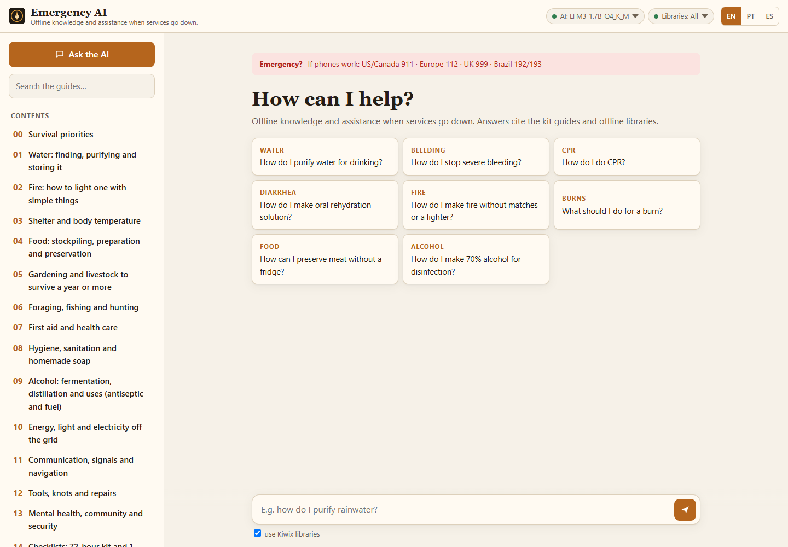

  

<h1 align="center">Emergency-AI</h1>

<strong>Practical emergency knowledge, available offline.</strong> Read guides, search reference libraries, and ask an AI emergency questions when the Internet is down.

  <a href="#install"><strong>Install</strong></a> ·
  <a href="docs/getting-started.md">Getting started</a> ·
  <a href="docs/using-emergency-ai.md">User guide</a> ·
  <a href="docs/troubleshooting.md">Help</a>

Windows · macOS · Linux English · <a href="README.pt.md">Português</a> · <a href="README.es.md">Español</a>

Download and configure Emergency-AI while you have internet, then use the downloaded guides, libraries, and AI model offline. The app opens in your browser and runs on your computer. You still need power-for example, a laptop with a charged battery.

**Watch Emergency-AI in action**

https://github.com/user-attachments/assets/653a4d45-961d-4599-a794-f7ebf48aed10

## What you can do

| Feature | What you can do |
|---|---|
| **Included guides** | Read and search practical information about water, food, shelter, first aid, repairs, energy, and more, in English, Portuguese, or Spanish. |
| **Optional AI Model** | Ask questions in everyday language. The local model uses retrieved passages to write answers; source links let you check the material. |
| **Extra libraries** | Download reference collections such as medical Wikipedia, repair guides, and post-disaster manuals for offline use. |
| **Phone access** | Use a phone's browser over the same local network while the app runs on your computer. |
| **Your documents** | Add text documents to the kit and include them in searches. |

**You can start without AI.** The included guides are ready to read and search without downloading a model or extra libraries.

## Before you start

- **Computer:** Windows 10/11, macOS, or Linux on a supported x86-64 or ARM64 system. See [platform details](docs/technical-reference.md#terminal-installation-and-platform-support).
- **Internet:** needed for installation and optional downloads. Prepare before an outage.
- **Memory:** the lightweight AI model recommends 8 GB system RAM. A dedicated graphics card is not required. Guide search does not need the AI model.
- **Storage:** extra libraries start at about 3 GiB; the lightweight model adds about 1.1 GB. Allow additional space for software, extraction, and updates. See [download choices](docs/downloads.md). Select library languages to reduce downloads—for example, `prepare --zims full --zim-languages pt,es` downloads only Portuguese/Spanish profile entries. English references can be added separately; existing files are kept.

The installer includes Python, the software that runs the app. You do not need to install Python or Git separately.

### Approximate disk space

These are suggested drive capacities, not guaranteed installation sizes:

| Capacity | Suggested use |
|---|---|
| **16 GB** | `minimal` libraries plus the lightweight LFM3 model, for one platform without optional CUDA packages. |
| **32 GB** | `recommended` libraries plus the balanced model, for one platform. |
| **64 GB** | `recommended` libraries plus the balanced model, with runtimes for all supported platforms and optional GPU support. |
| **256 GB or more** | `full` libraries, optional wikiHow/WikEM archives, additional models, and multiple platform runtimes. Check available space before downloading everything. |

The **16–64 GB suggestions exclude full Wikipedia and optional archives**. Actual requirements vary with downloads; leave room for extraction and updates.

- Models and knowledge files are shared across platforms, not duplicated for each OS. Platform-specific runtimes add space.
- CUDA means the project's CUDA runtime packages, not the full development toolkit or NVIDIA driver installers. Compatible drivers are still required on the host.
- Use **exFAT rather than FAT32** for cross-platform storage: some files exceed FAT32's 4 GB file-size limit.
- The largest currently listed model, **Qwen3.8 27B**, recommends **32 GB system RAM**. Disk capacity alone does not guarantee it will run well.
- For faster model loading, use a fast USB 3 drive or external SSD. Larger capacity alone does not mean faster storage.

## Install

Create a new, empty folder where you want to keep Emergency-AI. Save the installer for your computer in that folder. On GitHub, right-click the download link and choose **Save link as**.

| Computer | Download | Run the installer |
|---|---|---|
| **Windows** | [install.bat](https://raw.githubusercontent.com/skanga/Emergency-AI/main/install.bat) | Double-click `install.bat`. |
| **macOS** | [install.sh](https://raw.githubusercontent.com/skanga/Emergency-AI/main/install.sh) | Open Terminal in that folder and run `sh install.sh`. |
| **Linux** | [install.sh](https://raw.githubusercontent.com/skanga/Emergency-AI/main/install.sh) | Open a terminal in that folder and run `sh install.sh`. |

Need help opening a terminal or choosing downloads? Follow [Getting started](docs/getting-started.md). Experienced users can use the [terminal installation commands](docs/technical-reference.md#terminal-installation-and-platform-support).

**Windows installation walkthrough (2:19)** - download the installer, choose the lightweight model and minimal libraries, then search a guide and ask a question. Long download waits are trimmed from the video.

https://github.com/user-attachments/assets/3c3d246f-f09e-45c0-a4ba-8772f8008c8d

When the installer asks about first-time setup, choose **Y** to add AI and libraries now. For a small starting setup, choose **Recommended choices**, the lightweight **LFM3 1.7B** model, **minimal** libraries, and **this computer**. Choose these entries explicitly; pressing Enter at every prompt does not necessarily select minimal libraries.

To begin with only the included guides, skip first-time setup and open the app. At the first-use menu, choose **Use guides now and remember this choice**. You can add downloads later.

Downloads can take a long time. Keep the installer window open until it finishes. If a download fails, use the [recovery instructions](docs/troubleshooting.md#installation-or-downloads-stopped).

## Open it and try it

After installation, open the launcher in your Emergency-AI folder. Use the same launcher on future visits; you do not need to install again.

| Computer | Open the app |
|---|---|
| **Windows** | Double-click `run.bat`. |
| **macOS** | Double-click `run.command`. On first use, right-click and choose **Open** if needed. |
| **Linux** | Open a terminal in the folder and run `./run.sh`. |

Your browser should open at <http://127.0.0.1:8090>. Keep the app's terminal window open while using it.

1. Open a guide from the sidebar, or search for a topic such as **water**.
2. Try a question using **Ask the AI**. Without a model, the app shows source passages instead.
3. Open a source link under the response to read the original material.

Before relying on the kit offline, [test it without internet](docs/getting-started.md#check-that-it-works-offline). To stop the app, return to its terminal window and press **Ctrl+C**.

## Guides and help

These guides are included in the project folder so you can keep them with the kit. The videos above are hosted online.

| You want to… | Read |
|---|---|
| Install for the first time and choose setup options | [Getting started](docs/getting-started.md) |
| Use guides, questions, languages, and source links | [Using Emergency-AI](docs/using-emergency-ai.md) |
| Connect a phone | [Use it on your phone](docs/using-emergency-ai.md#use-it-on-your-phone) |
| Choose models or download more libraries | [Downloads and models](docs/downloads.md) |
| Add documents or move the kit to another computer | [User guide](docs/using-emergency-ai.md#add-your-own-documents) |
| Fix a failed download or an app that will not open | [Troubleshooting](docs/troubleshooting.md) |
| Configure engines, use terminal commands, or run tests | [Technical reference](docs/technical-reference.md) |

## Limitations

Emergency-AI is educational material, not a replacement for emergency services or professional medical care. AI answers can be wrong, and a citation does not prove that an answer is supported. The bundled guides have [known content issues awaiting review](TODO.md). Downloaded libraries are snapshots and may contain outdated information.

Local-network sharing is enabled by default. Connected devices can read indexed personal documents too. See [phone access and sharing controls](docs/using-emergency-ai.md#use-it-on-your-phone).

## Contributing and licenses

Corrections with sources, new guides, and translations are welcome. Keep a `> Source:` line in English sections containing technical or health guidance, and use the equivalent label in translations. Keep guide filenames consistent across languages. See [developer checks](docs/technical-reference.md#tests).

Code: [MIT](LICENSE). Included guides: [CC BY-SA 4.0](LICENSE-CONTENT.md). Downloaded software, libraries, and models have their own licenses; see [model choices](docs/downloads.md#model-choices).

Based on [IA da Sobrevivência](https://github.com/sdalberto/ia-da-sobrevivencia) by Silviano Dalberto Pessi (Ideias Livres Desenvolvimentos) and contributors. Original license and copyright notices are retained. Offline terminal QR codes use Project Nayuki's MIT-licensed [QR encoder](app/vendor/README.md).
