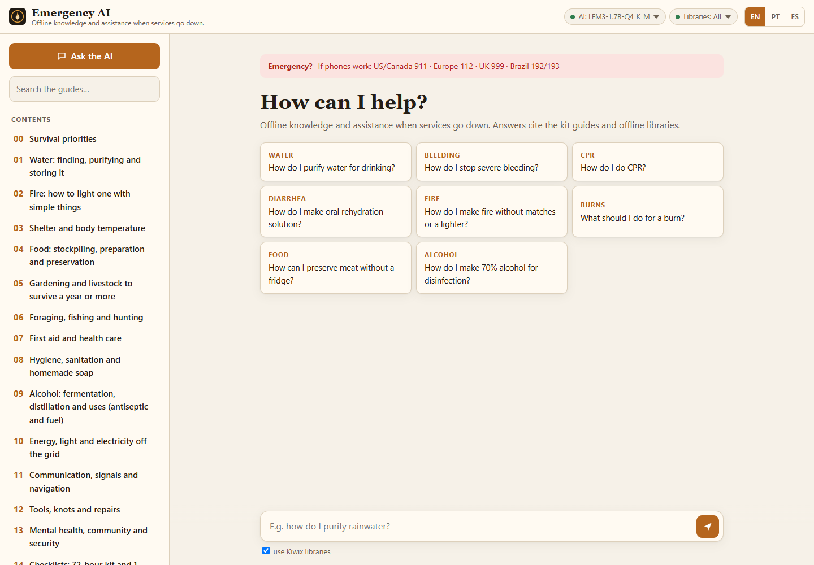

  

<h1 align="center">Emergency-AI</h1>

<strong>Conhecimento prático para emergências, disponível offline.</strong> Leia guias, pesquise em bibliotecas de referência e faça perguntas sobre emergências a uma IA quando a internet estiver fora do ar.

  <a href="#instalação"><strong>Instalar</strong></a> ·
  <a href="docs/getting-started.md">Primeiros passos</a> ·
  <a href="docs/using-emergency-ai.md">Guia de uso</a> ·
  <a href="docs/troubleshooting.md">Ajuda</a>

Windows · macOS · Linux <a href="README.md">English</a> · Português · <a href="README.es.md">Español</a>

Baixe e configure o Emergency-AI enquanto tiver internet; depois, use os guias, as bibliotecas e o modelo de IA baixados sem conexão. O aplicativo abre no navegador e roda no seu computador. Você ainda precisa de energia — por exemplo, um notebook com a bateria carregada.

**Veja o Emergency-AI em ação**

https://github.com/user-attachments/assets/653a4d45-961d-4599-a794-f7ebf48aed10

## O que você pode fazer

| Recurso | O que você pode fazer |
|---|---|
| **Guias incluídos** | Leia e pesquise informações práticas sobre água, alimentos, abrigo, primeiros socorros, reparos, energia e outros temas, em inglês, português ou espanhol. |
| **Modelo de IA opcional** | Faça perguntas em linguagem cotidiana. O modelo local usa trechos recuperados para escrever respostas; os links para as fontes permitem conferir o material. |
| **Bibliotecas extras** | Baixe coleções de referência, como a Wikipédia de medicina, guias de reparo e manuais pós-desastre, para usar sem conexão. |
| **Acesso pelo celular** | Use o navegador de um celular conectado à mesma rede local enquanto o aplicativo roda no computador. |
| **Seus documentos** | Adicione documentos de texto ao kit e inclua-os nas pesquisas. |

**Você pode começar sem IA.** Os guias incluídos estão prontos para leitura e pesquisa, sem baixar um modelo ou bibliotecas extras.

## Antes de começar

- **Computador:** Windows 10/11, macOS ou Linux em um sistema x86-64 ou ARM64 compatível. Veja os [detalhes de compatibilidade](docs/technical-reference.md#terminal-installation-and-platform-support).
- **Internet:** necessária para a instalação e os downloads opcionais. Prepare o kit antes de uma interrupção do serviço.
- **Memória:** recomendam-se 8 GB de RAM do sistema para o modelo leve de IA. Não é necessária uma placa de vídeo dedicada. A pesquisa nos guias não precisa do modelo de IA.
- **Armazenamento:** as bibliotecas extras começam em cerca de 3 GiB; o modelo leve acrescenta cerca de 1,1 GB. Reserve espaço adicional para o software, a extração e as atualizações. Veja as [opções de download](docs/downloads.md).

O instalador inclui o Python, o software que executa o aplicativo. Você não precisa instalar Python ou Git separadamente.

## Instalação

Crie uma pasta nova e vazia onde deseja guardar o Emergency-AI. Salve nela o instalador correspondente ao seu computador. No GitHub, clique com o botão direito no link de download e escolha **Salvar link como**.

| Computador | Download | Executar o instalador |
|---|---|---|
| **Windows** | [install.bat](https://raw.githubusercontent.com/skanga/Emergency-AI/main/install.bat) | Clique duas vezes em `install.bat`. |
| **macOS** | [install.sh](https://raw.githubusercontent.com/skanga/Emergency-AI/main/install.sh) | Abra o Terminal nessa pasta e execute `sh install.sh`. |
| **Linux** | [install.sh](https://raw.githubusercontent.com/skanga/Emergency-AI/main/install.sh) | Abra um terminal nessa pasta e execute `sh install.sh`. |

Precisa de ajuda para abrir um terminal ou escolher os downloads? Siga os [primeiros passos](docs/getting-started.md). Usuários experientes podem usar os [comandos de instalação no terminal](docs/technical-reference.md#terminal-installation-and-platform-support).

**Instalação no Windows passo a passo (2:19)** — baixe o instalador, escolha o modelo leve e as bibliotecas mínimas e, depois, pesquise em um guia e faça uma pergunta. As esperas longas dos downloads foram cortadas do vídeo.

https://github.com/user-attachments/assets/3c3d246f-f09e-45c0-a4ba-8772f8008c8d

Quando o instalador perguntar sobre a configuração inicial, escolha **Y** para adicionar a IA e as bibliotecas agora. Para começar com uma instalação pequena, escolha **Recommended choices**, o modelo leve **LFM3 1.7B**, as bibliotecas **minimal** e **this computer**. Selecione essas opções explicitamente; pressionar Enter em todas as perguntas não seleciona necessariamente as bibliotecas mínimas.

Para começar apenas com os guias incluídos, pule a configuração inicial e abra o aplicativo. No menu do primeiro uso, escolha **Use guides now and remember this choice**. Você pode adicionar os downloads depois.

Os downloads podem demorar bastante. Mantenha a janela do instalador aberta até ele terminar. Se um download falhar, consulte as [instruções de recuperação](docs/troubleshooting.md#installation-or-downloads-stopped).

## Abra o aplicativo e experimente

Após a instalação, abra o inicializador na pasta do Emergency-AI. Use o mesmo inicializador nas próximas vezes; não é necessário instalar novamente.

| Computador | Abrir o aplicativo |
|---|---|
| **Windows** | Clique duas vezes em `run.bat`. |
| **macOS** | Clique duas vezes em `run.command`. No primeiro uso, clique com o botão direito e escolha **Abrir**, se necessário. |
| **Linux** | Abra um terminal na pasta e execute `./run.sh`. |

O navegador deve abrir em <http://127.0.0.1:8090>. Mantenha a janela de terminal do aplicativo aberta enquanto o usa.

1. Abra um guia na barra lateral ou pesquise um tema como **água**.
2. Experimente fazer uma pergunta com **Ask the AI**. Sem um modelo, o aplicativo mostra trechos das fontes.
3. Abra um link de fonte abaixo da resposta para ler o material original.

Antes de depender do kit offline, [teste-o sem internet](docs/getting-started.md#check-that-it-works-offline). Para encerrar o aplicativo, volte à janela de terminal e pressione **Ctrl+C**.

## Guias e ajuda

Estes guias estão incluídos na pasta do projeto para que você possa mantê-los com o kit. Os vídeos acima estão hospedados na internet.

| Você quer… | Leia |
|---|---|
| Instalar pela primeira vez e escolher as opções de configuração | [Primeiros passos](docs/getting-started.md) |
| Usar os guias, as perguntas, os idiomas e os links para as fontes | [Uso do Emergency-AI](docs/using-emergency-ai.md) |
| Conectar um celular | [Uso pelo celular](docs/using-emergency-ai.md#use-it-on-your-phone) |
| Escolher modelos ou baixar mais bibliotecas | [Downloads e modelos](docs/downloads.md) |
| Adicionar documentos ou mover o kit para outro computador | [Guia de uso](docs/using-emergency-ai.md#add-your-own-documents) |
| Resolver um download que falhou ou um aplicativo que não abre | [Solução de problemas](docs/troubleshooting.md) |
| Configurar motores, usar comandos de terminal ou executar testes | [Referência técnica](docs/technical-reference.md) |

## Limitações

O Emergency-AI é material educativo, não um substituto dos serviços de emergência ou do atendimento médico profissional. As respostas da IA podem estar erradas, e uma citação não comprova que a fonte sustenta a resposta. Os guias incluídos têm [problemas de conteúdo conhecidos que aguardam revisão](TODO.md). As bibliotecas baixadas são cópias de um determinado momento e podem conter informações desatualizadas.

O compartilhamento na rede local está ativado por padrão. Os dispositivos conectados também podem ler documentos pessoais indexados. Veja os [controles de acesso e compartilhamento](docs/using-emergency-ai.md#use-it-on-your-phone).

## Contribuições e licenças

Correções com fontes, novos guias e traduções são bem-vindos. Mantenha uma linha `> Source:` nas seções em inglês que contenham orientação técnica ou de saúde e use o rótulo equivalente nas traduções. Mantenha os mesmos nomes de arquivo dos guias em todos os idiomas. Veja as [verificações para desenvolvedores](docs/technical-reference.md#tests).

Código: [MIT](LICENSE). Guias incluídos: [CC BY-SA 4.0](LICENSE-CONTENT.md). O software, as bibliotecas e os modelos baixados têm suas próprias licenças; veja as [opções de modelos](docs/downloads.md#model-choices).

Baseado em [IA da Sobrevivência](https://github.com/sdalberto/ia-da-sobrevivencia), de Silviano Dalberto Pessi (Ideias Livres Desenvolvimentos) e colaboradores. Os avisos originais de licença e direitos autorais foram mantidos. Os códigos QR offline exibidos no terminal usam o [codificador QR](app/vendor/README.md) do Project Nayuki, com licença MIT.
