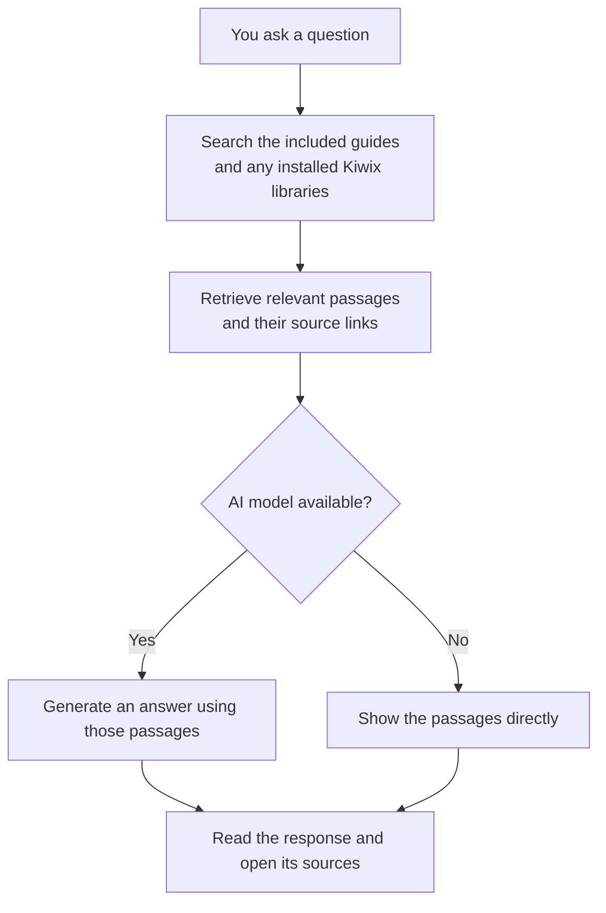

# Technical reference

[Home](../README.md) · [Getting started](getting-started.md) · [Using the app](using-emergency-ai.md) · [Downloads](downloads.md) · [Help](troubleshooting.md) · [Reference](technical-reference.md)

Most users can use the defaults. Start with [Getting started](getting-started.md) if you have not installed the app. Paths and commands below are relative to the Emergency AI folder.

## How it works

The kit combines **documents to read**, **software to search them**, and an optional **AI model to write answers**. You download the extra parts while you have internet, then use the saved copies offline. The included survival guides work without downloading a model or extra libraries.

See the [Glossary](#glossary) for explanations of the component names and file formats.



- **Works offline after setup:** guides, downloaded libraries, and the optional AI model stay on your computer.
- **The AI is optional:** it turns retrieved material into a conversational answer. Guide search works without it.
- **Sources remain visible:** readers can check the original material. If nothing relevant is found, the app says so.

| Part | What it is | Where |
|---|---|---|
| `emergency.py` + `app/` | Application and search logic (Python standard library only, no `pip install`) | repository |
| `knowledge/en/`, `knowledge/pt/`, `knowledge/es/` | Survival guides in Markdown | repository |
| `knowledge/extra/` | **Your** personal `.md`/`.txt` documents (searched and cited by the AI) | repository |
| `runtime/llama.cpp/` | Engine that runs the AI model | downloaded with `prepare` |
| `models/*.gguf` | Language model (size depends on your choice) | downloaded with `prepare` |
| `runtime/kiwix-tools/` + `zim/*.zim` | Kiwix server and libraries | downloaded with `prepare` |
| `runtime/python/` | Portable Python (for PCs without Python) | downloaded with `prepare` |

Keep downloaded models, libraries and runtimes out of git: the repository stays small and everyone builds their own kit with the `prepare` command.

---

## Other ways to use it

**Windows (PowerShell):**

```powershell
.\run.bat chat                   # terminal chat
.\run.bat ask "how do I make oral rehydration solution?"
.\run.bat search burn
.\run.bat status
.\run.bat start --local-only               # turn off local-network sharing
.\run.bat prepare --search survival        # find more Kiwix libraries
```

**Linux / macOS:**

```sh
./run.sh chat                   # terminal chat
./run.sh ask "how do I make oral rehydration solution?"
./run.sh search burn
./run.sh status
./run.sh start --local-only               # turn off local-network sharing
./run.sh prepare --search survival        # find more Kiwix libraries
```

**Ollama:** if you use [Ollama](https://ollama.com), run `ollama pull qwen2.5:3b` — it is detected automatically. Any local OpenAI-compatible server (LM Studio, llamafile, KoboldCpp, Jan) also works: set `llm_url`.

**Kiwix Desktop:** [Kiwix Desktop](https://kiwix.org) can open the `.zim` files in `zim/`. To let the AI use its *Local Kiwix Server*, set `{ "kiwix_url": "http://127.0.0.1:<port>" }` in `config/settings.local.json`. The Windows Kiwix Desktop package (~150 MB) exceeds GitHub's 100 MB per-file limit — publish it as a **Release asset** instead of committing it.

## Configuration

`config/settings.json` contains the defaults. Put overrides in `config/settings.local.json` to keep machine-specific choices separate from the shared settings. Keep that local file out of version control.

| Key | Default | Purpose |
|---|---|---|
| `language` | `en` | Default language (`en`, `pt`, `es`) |
| `web_host` | `0.0.0.0` | Share on the local network; use `127.0.0.1` for this computer only |
| `web_port` | `8090` | Web interface port |
| `llm_backend` | `auto` | `auto`, `llamacpp`, `openai` (generic compatible server), `ollama` or `none` |
| `llm_acceleration` | `auto` | Bundled llama.cpp: `auto` tries CUDA → Vulkan → CPU on Windows/Linux, Metal → CPU on macOS. `cuda` tries CUDA → Vulkan → CPU; `vulkan` / `metal` try that backend then CPU; `cpu` disables GPU use. External servers manage their own acceleration. |
| `model_file` | unset | Select a `.gguf` filename when several are installed |
| `llm_context` | `8192` | Model context size |
| `llm_max_tokens` | `2048` | Total generation allowance, including thinking where the backend counts it |
| `llm_context_margin` | `256` | Additional tokens reserved for template/counting differences |
| `llm_thinking` | backend-dependent | `false` for llama.cpp/Ollama; unset for generic compatible servers. See below. |
| `llm_threads` | `0` | CPU threads (0 = automatic) |
| `kiwix_url` | `http://127.0.0.1:8092` | Kiwix server address |
| `search_results` | `5` | Guide passages sent to the AI |

Ollama must have the exact configured model tag installed. An untagged name resolves to `:latest`; an absent model falls back to guide search.

For example, to select a different Ollama model:

```json
{ "ollama_model": "llama3.2:3b" }
```

### Generation and thinking

Generation settings can be overridden per backend and per exact model. Precedence is global `llm_*` defaults, catalogue sampler presets for a recognized llama.cpp filename, then `llm_backend_settings`, then `llm_model_settings`. Catalogue sampler presets do not override your thinking request. For example:

```json
{
  "llm_backend_settings": {
    "llamacpp": { "max_tokens": 4096, "context": 16384, "thinking": false },
    "ollama": { "max_tokens": 4096, "context": 16384, "thinking": false }
  },
  "llm_model_settings": {
    "ollama": {
      "qwen3:4b": { "thinking": true, "max_tokens": 6144 }
    }
  }
}
```

This example configures an already-installed model; it does not download one or change the catalogue. Override keys are `max_tokens`, `context`, `temperature`, `thinking`, `context_margin`, `top_p`, `top_k`, `min_p`, `presence_penalty` and `repeat_penalty`. Generic compatible servers accept the standard `top_p` and `presence_penalty` fields; the other sampler extensions require llama.cpp or Ollama. For a catalogue model, use a backend or exact-model override to replace its sampler preset. Model keys are the GGUF filename for the managed llama.cpp launcher, the exact server-reported model identifier for generic servers, or the full Ollama tag including `:latest` when applicable. A llama.cpp server using an alias needs that alias as its client-side model key. Restart the kit after editing settings; a larger context can require more memory.

For llama.cpp and Ollama, `thinking` accepts `true`, `false`, `null` (server/model default), or a supported effort name. Generic `openai` servers accept `null` or an effort name supported by that server; llama.cpp-specific fields are not sent to them. `auto` identifies llama.cpp through its server properties, otherwise treats the endpoint as generic. Use `llm_backend: "llamacpp"` if a proxy hides those properties. Thinking controls depend on the model/template; a model that always reasons may not honor an off request. See the [llama.cpp server documentation](https://github.com/ggml-org/llama.cpp/blob/master/tools/server/README.md) and [Ollama thinking documentation](https://docs.ollama.com/capabilities/thinking).

Reasoning fields are consumed separately and discarded, never added to the visible answer or conversation history. Inline `<think>` blocks are also filtered. There is no universal separate reasoning-token budget across these APIs: `max_tokens` is the total generation allowance, so enable thinking with enough room for the final answer. The app never automatically retries or continues an incomplete answer.

Before generation, the app reserves output space and the context margin, removes oldest conversation turns if needed, then omits entire lower-ranked source sections while keeping their links. It never shortens the current question or cuts a source section mid-procedure. If the question cannot fit, or no complete source fits, it shows source passages instead. llama.cpp uses its rendered prompt and tokenizer when available and respects a smaller reported server context. Other servers, including Ollama, use a conservative UTF-8 byte estimate plus message overhead. This estimate is not an exact token count; configure the context no larger than the model/server supports. Ollama receives the configured context on each request; an external server's context must be configured separately.

Token-limit stops and streams without a confirmed normal finish display an **Incomplete answer** notice in both the browser and terminal. The API's final `done` event includes `generation` metadata with the finish reason, completion status and budgets. If a model produces only reasoning, the app falls back to source passages.

The server limits request bodies to 64 KiB, accepts one answer stream at a time, and returns HTTP 503 while another answer is running. Share only with trusted devices: LAN clients can read all indexed documents, including `knowledge/extra/`.

## Acceleration and updates

Each preparation run checks for the newest available llama.cpp build for the selected platforms, upgrades older installations, and skips re-downloading the current build. Normal offline startup never checks for updates.

Preparation includes separate CPU and Vulkan engines for Windows/Linux (x86-64 and ARM64) when the release provides them. macOS uses the Metal-capable engine, which also supports CPU execution. On every launch, the app probes the current computer for usable GPU devices, enables automatic GPU-layer placement and memory fitting, and reports the selected backend and devices in the console. Auto tries an installed CUDA engine first, then Vulkan, then CPU on Windows/Linux; macOS tries Metal, then CPU. Missing drivers, failed GPU startup, or a five-minute loading timeout move to the next backend. Drivers must already be installed; startup does not download anything. NPU packages are not included.

For an existing kit, rerun preparation to add the accelerated engine. If setup choices were previously saved, use `.\run.bat prepare --resume --yes` on Windows or `./run.sh prepare --resume --yes` on Linux/macOS to keep those choices. CPU and Vulkan libraries stay in separate folders (`runtime/llama.cpp/<platform>/` and `<platform>-vulkan/`) so the kit can move between machines with different graphics hardware.

**Optional NVIDIA CUDA:** interactive setup offers CUDA when `nvidia-smi` detects an NVIDIA GPU. For an existing kit with saved choices, run `.\run.bat prepare --resume --cuda --yes` (Windows) or `./run.sh prepare --resume --cuda --yes` (Linux). For a new kit, add `--cuda` to `prepare`; it also works when preparing for a different computer with `--os`. CUDA adds roughly 0.6–0.8 GB of downloads per selected Windows/Linux platform, plus extraction space. The engine and its matching runtime libraries are installed together in `<platform>-cuda/`; the full CUDA development toolkit is unnecessary. Preparation picks the newest CUDA version with a matching library archive in the selected llama.cpp release (currently CUDA 13 where available). Older GPUs/drivers may be incompatible, in which case startup falls back to Vulkan/CPU. NVIDIA detection only controls the offer; actual CUDA compatibility is checked at launch.

The CUDA download choice is saved for `--resume`. Unattended new setup does not add CUDA unless `--cuda` is specified. `--no-cuda` skips future CUDA downloads without deleting an installed engine; set `llm_acceleration` to `vulkan` or `cpu` to avoid using it.

### WSL CUDA library selection

On Linux kernels identified as WSL, CUDA probing and model startup use the same library selection. The launcher checks `/usr/lib/wsl/lib` for a CUDA driver and PTX compiler pair. Otherwise it looks for a driver-store directory under `/usr/lib/wsl/drivers` whose `libcuda.so.1.1` matches `/usr/lib/wsl/lib/libcuda.so.1` by file identity and includes `libnvidia-ptxjitcompiler.so.1`. This supports hard links as well as symlinks.

Some WSL versions use a small forwarding library instead. If no file identity matches, the launcher accepts exactly one complete driver-store pair. Multiple unmatched candidates are left unresolved; it never selects a version by directory-name ordering. Missing or inaccessible WSL files leave the existing environment and backend fallback usable.

For CUDA children, the selected WSL directory precedes the engine directory and inherited `LD_LIBRARY_PATH` entries. Empty and duplicate entries are removed. The parent environment is unchanged, and WSL driver paths are not injected into Kiwix, Vulkan, CPU, Windows, or macOS processes. No driver-store name is hardcoded. `logs/gpu-probe.log` retains timestamped probe output, exit codes, and the WSL directory selection; `logs/llm.log` contains model startup output.

### Kiwix startup readiness

The launcher validates the Atom feed at `/catalog/v2/entries?count=1` before reusing an occupied Kiwix port or reporting a newly spawned server ready. A new process gets a 30-second readiness window with short HTTP timeouts. Failed children are reaped, and cancellation during the readiness wait cleans up launcher-owned processes.

Binding starts at `127.0.0.1`. On WSL only, a child that exits with `ERROR: IP address is not available on this system: 127.0.0.1` is retried once with `--address ipv4`. Only output from the current attempt is examined; older appended log messages cannot trigger the retry. This fallback binds all IPv4 interfaces and is announced in the terminal. The client URL remains `http://127.0.0.1:8092` (or the configured port). The retry has its own readiness window. Other failures preserve loopback-only binding and are reported with the `logs/kiwix.log` location.

## Download integrity and disk checks

Preparation verifies model checksums and Kiwix metalink sizes/checksums. A failed ZIM update keeps the previous library, and interrupted downloads remain available for retry. Invalid selections and failed preparation return a nonzero exit code; `runtime/kit-info.json` records the result of each requested component.

The initial model/library size is an estimate before reusing existing files. Space checks happen on each component's destination drive: verified completed downloads need no additional download space, and partial downloads count only the remaining bytes. ZIP/tar extraction uses the archive's uncompressed sizes, including file copies made from links on Windows, plus a conservative 64 KiB allowance per entry and one directory allowance for filesystem overhead. Existing runtimes and libraries remain in place during replacement; free space is checked while both the old files and downloaded archive are still present. Downloads with unknown sizes use response headers when available, or check space as data arrives. Insufficient space stops that component without deleting its previous installation or partial download. There is no blanket 1 GiB requirement on a completed kit.


## Installer details

### Terminal installation and platform support

Open a terminal where you want to keep the kit. The installer uses the current folder if it is empty, named `Emergency-AI`, or at the top level of a drive or mounted volume. Otherwise it creates an `Emergency-AI` subfolder.

The destination must be empty apart from installer files and folder metadata (`.DS_Store`, `Thumbs.db`). The installer downloads the application, launchers and a checksum-verified portable Python for this computer. You need internet, but no administrator rights.

**Windows (PowerShell):**

```powershell
curl.exe -fL https://raw.githubusercontent.com/skanga/Emergency-AI/main/install.bat -o install.bat
if ($LASTEXITCODE -eq 0) { .\install.bat }
```

**Linux / macOS:**

```sh
curl -fL https://raw.githubusercontent.com/skanga/Emergency-AI/main/install.sh -o install.sh && sh install.sh
```

These commands save the installer before running it. To inspect it first, run only the download command. The Windows batch file includes its PowerShell code. Only run installers from a source you trust.

To choose another folder, run `.\install.bat "My kit"` or `sh install.sh "My kit"`. Its parent folder must already exist. The same empty-folder rule applies: the installer preserves downloaded installer files and refuses to overwrite an existing kit.

Downloads show progress and retry up to three times if a connection fails or stalls. Rerun the installer after an interruption to resume the Python download. If the server cannot resume, the download starts over. Completed Python downloads are checked against their SHA-256 before reuse; invalid files are removed. Application source is downloaded again on each run because `main` can change.

For a destination named `Emergency-AI`, look in the sibling folder `.Emergency-AI-downloads` for `install.log` and the cached Python download. At a drive or mounted-volume root, the cache and temporary staging folder stay inside that root. You can delete the cache after installation to reclaim space.

Supported systems (x86-64 and ARM64):

- Windows 10/11 with PowerShell, `curl.exe` and `tar.exe`.
- Linux with glibc, `curl`, `tar` and `sha256sum`.
- macOS with `curl`, `tar` and `shasum`.

The installer uses Python 3.12.16 from the [official standalone Python release](https://github.com/astral-sh/python-build-standalone/releases/tag/20261110) and checks its SHA-256 before extraction. Application code comes from the current `main` branch over HTTPS. Choose optional models and Kiwix libraries during [first-time setup](getting-started.md#choose-your-downloads).

**Alternative for developers:** clone with Git (requires Python 3.8+ already installed or a compatible portable Python in the kit):

```bash
git clone https://github.com/skanga/Emergency-AI.git
cd Emergency-AI
```

## Retrieval behavior

Search answers preserve complete guide sections. A section or Kiwix article that cannot fit the context budget is linked for reading in full instead of displaying a cut-off procedure. Search previews remain short; open the source for the complete instructions.

## Tests

```bash
python -B -m unittest discover -s tests
node --check web/app.js
```

GitHub Actions runs the Python tests on Windows, Linux and macOS with Python 3.11 and 3.14. The tests use temporary artifacts and mock services; they do not download full models or ZIM libraries.

Real-model checks run separately: see the [manual harness](../tests/manual/README.md).

## Glossary

| Name | In plain English |
|---|---|
| **[Kiwix](https://get.kiwix.org/en/)** | Free software for reading saved copies of websites without internet. This kit uses its small local server, `kiwix-serve`, so your browser and the assistant can open and search those copies. |
| **ZIM file (`.zim`)** | A compressed package of pages and their images, often an entire website or book collection. Put these files in `zim/`. They hold the reference material; the separate AI model writes answers from retrieved passages. |
| **Library / snapshot** | A collection saved at a particular time. A date such as `2024-09` means the September 2024 edition. Its pages do not update while you are offline. |
| **[WikEM](https://wikem.org/wiki/About_WikEM)** | An emergency medicine reference aimed at medical practitioners. The optional copy offered here is from **June 2020** and may contain outdated medical guidance. |
| **Medical Wikipedia / WikiMed** | Wikipedia articles about medicine and health, collected for offline reading. This is a separate collection from WikEM. The English collection is included in the smallest download profile. |
| **wikiHow** | Illustrated guides to everyday tasks, repairs and other practical activities. The optional archived editions here are from 2023 or 2024. |
| **iFixit, Appropedia, Energypedia** | Reference websites covering device repairs, practical sustainable technology, and energy respectively. Their offline copies are in the `recommended` profile. |
| **AI model / language model** | A large file of learned patterns that lets the computer generate text. It can make mistakes; the source links let you check its answers. You can use guide search without it. |
| **llama.cpp / Ollama** | Programs that run an AI model on your computer. The `prepare` command installs llama.cpp; Ollama is an optional alternative if you already use it. |
| **GGUF (`.gguf`)** | The file format used for the models downloaded by this kit. Model files go in `models/`; library files go in `zim/`. |
| **Python / portable Python** | Python runs the Emergency AI application. A portable copy travels inside the kit so another computer can run it without a separate installation. |
| **Setup / profile** | Run `.\run.bat prepare` on Windows, `./run.sh prepare` on Linux/macOS to choose and download components. Setup is also offered in the first-use menu. A profile is a named bundle of libraries: `minimal`, `recommended` or `full`. |
| **GiB / MiB** | Units of file size: 1 GiB = 1,024 MiB, about 1.07 GB. Download sizes in these guides are approximate; leave extra room for the model, software and future updates. |
